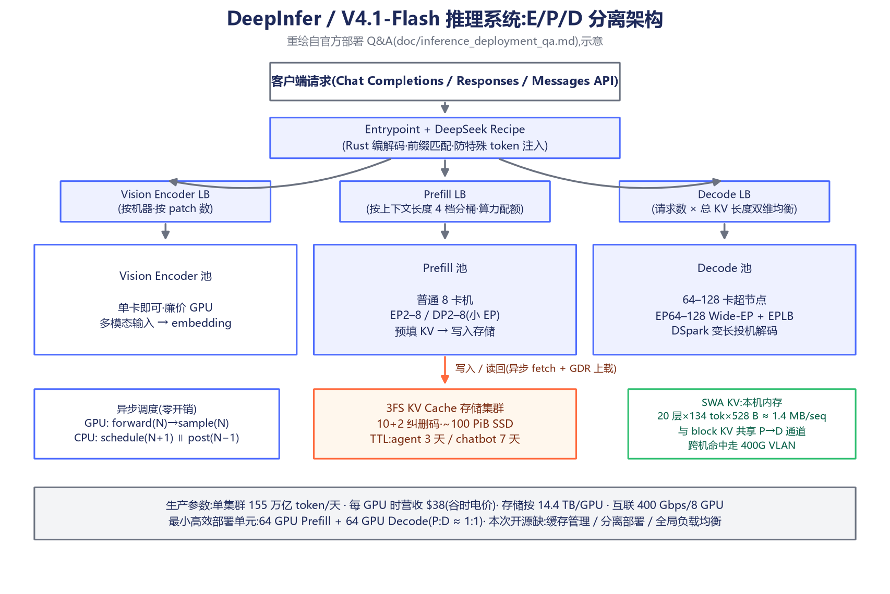
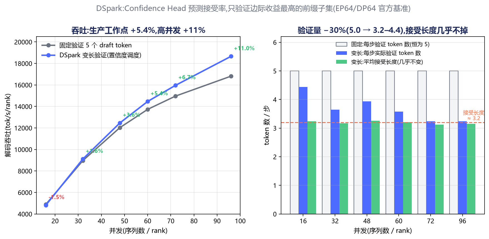
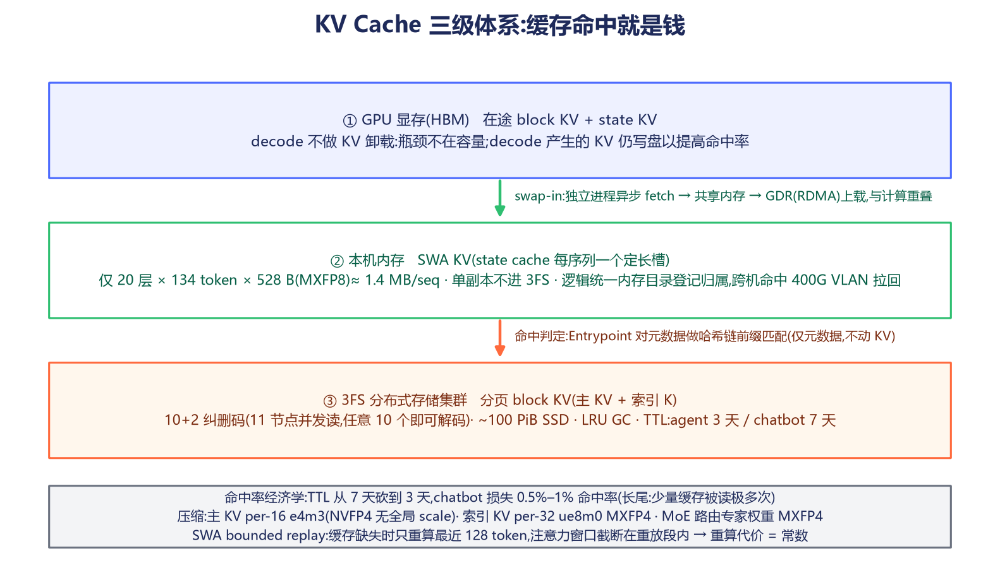
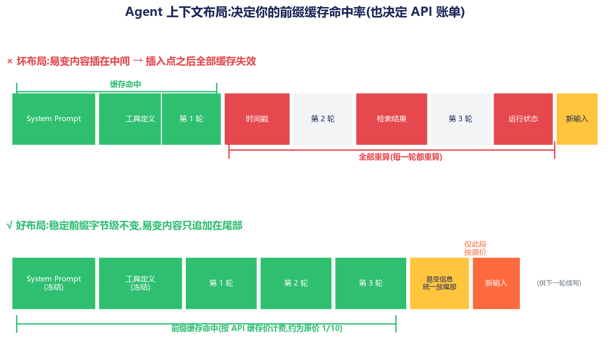

# DeepInfer 研究笔记:一个 Agent 开发者看 DeepSeek 开源推理框架

> 2026-10-20,DeepSeek 开源了 DeepInfer——支撑其线上服务的生产级推理框架(Apache 2.0)。
> 我把仓库拉下来读了一遍(重点读了 `doc/inference_deployment_qa.md` 和模型实现代码),
> 这篇笔记记录我作为普通 Agent 开发者看到的东西,以及**能搬回自己日常开发里的东西**。
>
> 仓库:[deepseek-ai/DeepInfer](https://github.com/deepseek-ai/DeepInfer) · 配套:[deepseek-ai/deepseek-recipe](https://github.com/deepseek-ai/deepseek-recipe)

## TL;DR

1. **DeepInfer 不是"推理模型",是"推理框架"**——DeepSeek 用来在生产环境跑模型的软件系统,和 vLLM / SGLang / TensorRT-LLM 同类,基于 vLLM 构建,跑的模型是 DeepSeek-V4.1-Flash。
2. 真正值钱的是它公开了**生产级 MoE 推理的完整方法论**:Wide-EP、变长投机解码验证、SWA 有界重放、确定性推理——这些通常是厂商最私有的资产。
3. 对 Agent 开发者,kernel 学不了也不用学;值得抄的是四件事:**流式解析模式(防注入)、缓存友好的上下文设计、按置信度分配算力、确定性纪律**。

---

## 一、它到底是什么

| | |
|---|---|
| 定位 | DeepSeek 生产推理引擎的离线推理版本 |
| 协议 | Apache 2.0,约 285 个源码文件(C++/CUDA + Python) |
| 支持模型 | DeepSeek-V4.1-Flash |
| 硬件 | NVIDIA SM100(Blackwell)与华为昇腾 950 **完全同等支持**(依赖、算子库全部双份) |
| 血统 | README 自述:主要基于 vLLM,借鉴 SGLang 与 TensorRT-LLM |
| 自带算子 | FlashMLA / DeepGEMM / DeepEP / DeepSelect(vendor/ 目录,均含 Ascend 版) |

一个容易踩的坑:中文语境里"推理"有歧义。DeepInfer 的"inference"是**部署计算**意义上的推理,不是 reasoning(思维链)。它不思考,它负责让会思考的模型便宜、快速、稳定地跑起来。

**没开源的部分同样重要**:KV cache 管理系统、E/P/D 分离式部署基础设施、跨副本负载均衡(与内部基础设施耦合太紧,2025 年 4 月他们曾因此放弃开源)。所以这是"核心能力包",不是开箱即用的服务栈。

## 二、系统架构:围绕"普通硬件"做分离

官方 Q&A 披露的设计目标非常朴素:**用普通 8 卡机做 prefill、普通 64–128 卡超节点做 decode,把 KV 缓存留 72 小时以上**。整个系统是围绕这三个约束长出来的。

几个我认为最有味道的决策:

- **E/P/D 三阶段分离**:Vision Encoder、Prefill、Decode 各自独立扩缩容、独立负载均衡。好处是 TTFT 和 TBT 可以分开优化——这两个指标的最优资源配置完全不同,耦合在一起必然顾此失彼。
- **Decode 用 Wide-EP(EP64–128)**:MoE 专家打散到几十张卡上,大幅降低每步访存流量,配合 EPLB(冗余专家 + 动态重分配,实测负载不均衡度仅 1.045–1.09)换取吞吐。Prefill 反而用最小 EP(EP2–8),只要显存装得下。
- **最小高效部署单元 = 64 卡 prefill + 64 卡 decode**。看到这个数字,普通开发者自己部署的念头可以打消了。

## 三、最有技术含量的三件事

### 1. DSpark:按置信度做变长投机验证

传统投机解码固定验证 N 个 draft token,不管每个 token 被接受的概率。DSpark 给 draft 模型加了一个 **Confidence Head**,预测每个 draft token 的接受概率,只验证"边际收益最高"的前缀子集。

官方给了 EP64/DP64 的实测数据(这也是我画下图的原因,表格放 README 里不够直观):

验证 token 数从 5.0 降到 3.2–4.4(-30%),接受长度几乎不变,生产工作点(每 rank 60 并发)吞吐 **+5.4%,96 并发时 +11%**。注意低并发时它甚至是负收益(-1.5%)——**优化要针对工作点,不是全域最优**。

还有个工程细节很精彩:因为异步调度下 CPU 拿不到上一步的置信度,每个请求该验证多长是由一个 TileLang kernel 直接在 GPU 上算完的(累乘 → 全局排序 top-k → 融合 scatter)。CPU 只定总预算。

### 2. SWA bounded replay:重放代价与上下文长度无关

V4.1-Flash 用 YOCO + CED 架构,decoder 的 block KV 可以由最后一个 encoder 层的隐状态投影得到,但精确重建 decoder 的 SWA KV 需要重算 2560 token × 20 层。DeepInfer 的做法:**只重算最近 128 个 token**,注意力窗口截断在重放段内,代价变成常数,**prefill 计算量近乎减半**。

这本质上是"有损但有界"的权衡:接受一个近似结果,把 O(历史长度) 的代价压成 O(1)。

### 3. 确定性推理

Batch-invariant(不同 batch 组合结果完全一致)+ 固定 `seq_seed` 的确定性采样。生产系统出问题时可复现,这比性能优化更体现工程成熟度。

## 四、KV 缓存三级体系:缓存命中就是钱

三个数字值得记住:

- 存储集群按 **每 GPU 14.4 TB** 逻辑容量配置,TTL 上 agent 流量 3 天、chatbot 流量 7 天;
- chatbot 流量"少量缓存被读非常多次"的长尾特征,使得 TTL 从 7 天砍到 3 天就要损失 0.5%–1% 命中率;
- 量化很激进:主 KV 用 FP4(per-16 e4m3),indexer KV 和 MoE 路由专家权重都是 MXFP4。

整个体系回答的问题只有一个:**怎么让"重复计算"尽可能少发生**。单集群每天 155 万亿 token、每 GPU 时营收 38 美元,靠的就是这些。

## 五、Agent 开发者能搬走什么

这是我最想写的部分。以下按实用程度排序。

### 1. 缓存友好的上下文布局(直接省钱)

API 的缓存计费背后就是上面那套 KV 体系,你可以反过来利用它:

规则一句话:**稳定内容放前面且保持字节级不变,易变内容只追加在尾部**。在对话中间插入时间戳、检索结果、运行状态,会让之前所有轮次的缓存全部作废。另外让同一会话粘在同一个路由上——缓存留在"产出它的那台机器/集群"里。

### 2. 流式解析的三个防御性细节(来自 deepseek-recipe)

- **用 token ID 匹配特殊标记,不要用文本匹配**。用户在工具返回值里塞一段 `</think>` 的字面文本,按 token ID 识别就不会误触发。很多 agent 框架的解析器是字符串匹配的,这是实打实的注入面。
- **增量 KMP 跨块匹配分隔符**:marker 被切在两个 chunk 之间时保留匹配进度,已确定内容立即下发,不回头重扫。
- **工具参数流式产出**:tool name 一解析完就返回,JSON 参数按边界逐段 escape 逐段吐,不要攒完整对象再序列化。

### 3. "按置信度分配算力"的普遍形态

DSpark 的思想抽出来就是:**预测每个候选的接受概率,把验证算力花在边际收益最高的地方,而不是平均分配**。Agent 层面的对应:

- 模型级联:便宜模型先答,自评分数 / logprobs / 格式校验可疑才升级贵模型;
- 校验分级:schema 校验(便宜)全跑,语义校验(贵)只对可疑输出跑。

### 4. 生成与后处理重叠

DeepInfer 的零开销调度器让 GPU 跑第 N 步时,CPU 并发做第 N+1 步调度和第 N−1 步后处理。Agent 循环同构:`生成 → 解析 → 工具执行 → 回填`。常见低效写法是串行等待;正确姿势是 token 一到就开始解析、工具参数一完整就发起执行、执行期间继续消费后续 token。

### 5. 确定性纪律

评测时固定 seed、temperature=0、模型版本,记录完整请求;否则你分不清"改 prompt 的效果"和"采样抖动 + 供应商侧 batching 引入的噪声"。样本跑多次看分布。

### 6. 服务层的几个负载均衡启发式(如果你自己跑网关)

- 按上下文长度分桶、独立配额,防止长尾请求堵死短请求(Head-of-line blocking);
- 按"消耗量"而非"请求数"均衡多上游;
- worker 下线时进入宽限期,把在途请求连同状态转发给同侪再退出;
- 扩容看对信号:按实际 token 吞吐,不是请求数。

## 六、冷静的部分

- 只支持 SM100 和昇腾 950,Hopper 都不支持——个人本地跑基本无缘,这是给有超节点的人看的代码;
- 没有缓存管理和服务化组件,想搭完整服务得自己补 E/P/D 分离与负载均衡;
- 模型本身(V4.1-Flash 的权重在 HuggingFace 上是开放的,但架构代码揭示了 `kv_source_layer_ids`(YOCO)、`compress_ratios`(CED)、`dspark_*`(draft 也是个小 MoE)这些设计,说明框架与模型是深度协同设计的——**这份框架换一个模型并不能直接用**,它是"DeepSeek 模型专用形状"的推理系统。

## 七、总结

DeepInfer 的价值不在"又一个推理引擎",而在于一家把推理成本打到极致的公司,把**生产方法论**开源了:怎么分离阶段、怎么压缓存、怎么按置信度花算力、怎么做到确定性。

对 Agent 开发者,我的总结是一句话:

> **Kernel 学不了也不用学;但"上下文怎么排、token 怎么流式解析、算力按置信度分配、怎么做到可复现",是我们每天都在做的四个问题,DeepInfer 给的是生产级的参考答案。**

## 参考资料

- [deepseek-ai/DeepInfer](https://github.com/deepseek-ai/DeepInfer) — 主仓库(本笔记基于其 `doc/inference_deployment_qa.md` 与源码)
- [deepseek-ai/deepseek-recipe](https://github.com/deepseek-ai/deepseek-recipe) — API 协议↔token 转换层,对流式解析细节更直接
- [Quartz: DeepSeek open-sources DeepInfer](https://qz.com/deepseek-open-source-deepinfer-inference-software-ai-102026)
- [The New Stack: DeepInfer Huawei Nvidia](https://thenewstack.io/deepseek-deepinfer-huawei-nvidia)
- 深度解读官方知乎博客(架构图与 EPLB/负载均衡设计,由 Q&A 文档引用)

---

*配图由 `scripts/gen_figures.py` 生成(数据图取自官方 doc 基准表,示意图为作者根据文档重绘)。*
